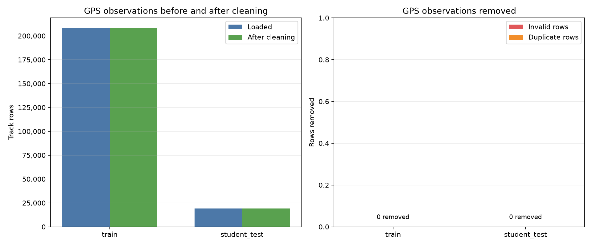

# Data cleaning and validation report

This report summarizes the supplied partitions after loading, cleaning, and validation. Raw validation issues are reported before cleaning; post-clean issues are checked before feature generation.

## Partition summary

| Partition | Trip folders | Cleaned/validated | Used for modeling | Dropped: empty tables | Raw track rows | Clean track rows | Track retained | Invalid removed | Duplicates removed | Post-clean issues | Candidate rows | Candidate coverage |
| --- | ---: | ---: | ---: | ---: | ---: | ---: | ---: | ---: | ---: | ---: | ---: | ---: |
| train | 80 | 80 | 80 | 0 | 208,417 | 208,417 | 100.00% | 0 | 0 | 0 | 17,485 | 89.08% |
| student_test | 10 | 10 | 10 | 0 | 19,160 | 19,160 | 100.00% | 0 | 0 | 0 | 2,154 | 99.79% |

## Track cleaning figures

## Table row counts

Loaded counts include all discovered trips. After-cleaning counts include trips that passed required-table checks and were cleaned; dropped trips are excluded.

| Partition | Table | Loaded rows | After cleaning |
| --- | --- | ---: | ---: |
| train | track | 208,417 | 208,417 |
| train | nodes | 1,933,485 | 1,933,485 |
| train | arcs | 3,876,904 | 3,876,904 |
| train | route | 31,336 | 31,336 |
| student_test | track | 19,160 | 19,160 |
| student_test | nodes | 90,689 | 90,689 |
| student_test | arcs | 185,041 | 185,041 |
| student_test | route | 3,477 | 3,477 |

## Validation findings before cleaning

| Partition | Issue found | Trips reporting issue |
| --- | --- | ---: |
| All partitions | None | 0 |

## Validation findings after cleaning

No remaining validation issues were found in trips that passed cleaning.

## Per-trip audit

| Partition | Trip | Status | Track rows (loaded → cleaned) | Invalid removed | Duplicates removed | Raw validation issues |
| --- | --- | --- | ---: | ---: | ---: | ---: |
| train | 00000001 | Included in model dataset | 1,315 -> 1,315 | 0 | 0 | 0 |
| train | 00000002 | Included in model dataset | 7,243 -> 7,243 | 0 | 0 | 0 |
| train | 00000003 | Included in model dataset | 821 -> 821 | 0 | 0 | 0 |
| train | 00000004 | Included in model dataset | 1,064 -> 1,064 | 0 | 0 | 0 |
| train | 00000005 | Included in model dataset | 1,045 -> 1,045 | 0 | 0 | 0 |
| train | 00000006 | Included in model dataset | 1,450 -> 1,450 | 0 | 0 | 0 |
| train | 00000008 | Included in model dataset | 3,093 -> 3,093 | 0 | 0 | 0 |
| train | 00000010 | Included in model dataset | 2,711 -> 2,711 | 0 | 0 | 0 |
| train | 00000011 | Included in model dataset | 2,828 -> 2,828 | 0 | 0 | 0 |
| train | 00000012 | Included in model dataset | 1,608 -> 1,608 | 0 | 0 | 0 |
| train | 00000013 | Included in model dataset | 2,580 -> 2,580 | 0 | 0 | 0 |
| train | 00000014 | Included in model dataset | 448 -> 448 | 0 | 0 | 0 |
| train | 00000016 | Included in model dataset | 1,305 -> 1,305 | 0 | 0 | 0 |
| train | 00000018 | Included in model dataset | 379 -> 379 | 0 | 0 | 0 |
| train | 00000019 | Included in model dataset | 2,354 -> 2,354 | 0 | 0 | 0 |
| train | 00000020 | Included in model dataset | 2,353 -> 2,353 | 0 | 0 | 0 |
| train | 00000021 | Included in model dataset | 15,783 -> 15,783 | 0 | 0 | 0 |
| train | 00000022 | Included in model dataset | 474 -> 474 | 0 | 0 | 0 |
| train | 00000024 | Included in model dataset | 801 -> 801 | 0 | 0 | 0 |
| train | 00000025 | Included in model dataset | 1,179 -> 1,179 | 0 | 0 | 0 |
| train | 00000026 | Included in model dataset | 361 -> 361 | 0 | 0 | 0 |
| train | 00000027 | Included in model dataset | 694 -> 694 | 0 | 0 | 0 |
| train | 00000028 | Included in model dataset | 3,565 -> 3,565 | 0 | 0 | 0 |
| train | 00000029 | Included in model dataset | 733 -> 733 | 0 | 0 | 0 |
| train | 00000031 | Included in model dataset | 4,245 -> 4,245 | 0 | 0 | 0 |
| train | 00000032 | Included in model dataset | 2,464 -> 2,464 | 0 | 0 | 0 |
| train | 00000033 | Included in model dataset | 5,844 -> 5,844 | 0 | 0 | 0 |
| train | 00000034 | Included in model dataset | 3,614 -> 3,614 | 0 | 0 | 0 |
| train | 00000035 | Included in model dataset | 1,643 -> 1,643 | 0 | 0 | 0 |
| train | 00000036 | Included in model dataset | 1,368 -> 1,368 | 0 | 0 | 0 |
| train | 00000037 | Included in model dataset | 677 -> 677 | 0 | 0 | 0 |
| train | 00000038 | Included in model dataset | 1,287 -> 1,287 | 0 | 0 | 0 |
| train | 00000039 | Included in model dataset | 363 -> 363 | 0 | 0 | 0 |
| train | 00000041 | Included in model dataset | 1,019 -> 1,019 | 0 | 0 | 0 |
| train | 00000042 | Included in model dataset | 7,739 -> 7,739 | 0 | 0 | 0 |
| train | 00000043 | Included in model dataset | 2,322 -> 2,322 | 0 | 0 | 0 |
| train | 00000044 | Included in model dataset | 546 -> 546 | 0 | 0 | 0 |
| train | 00000045 | Included in model dataset | 640 -> 640 | 0 | 0 | 0 |
| train | 00000046 | Included in model dataset | 1,401 -> 1,401 | 0 | 0 | 0 |
| train | 00000047 | Included in model dataset | 1,272 -> 1,272 | 0 | 0 | 0 |
| train | 00000048 | Included in model dataset | 1,240 -> 1,240 | 0 | 0 | 0 |
| train | 00000050 | Included in model dataset | 518 -> 518 | 0 | 0 | 0 |
| train | 00000051 | Included in model dataset | 984 -> 984 | 0 | 0 | 0 |
| train | 00000053 | Included in model dataset | 1,304 -> 1,304 | 0 | 0 | 0 |
| train | 00000054 | Included in model dataset | 19,313 -> 19,313 | 0 | 0 | 0 |
| train | 00000055 | Included in model dataset | 2,472 -> 2,472 | 0 | 0 | 0 |
| train | 00000057 | Included in model dataset | 1,645 -> 1,645 | 0 | 0 | 0 |
| train | 00000058 | Included in model dataset | 599 -> 599 | 0 | 0 | 0 |
| train | 00000060 | Included in model dataset | 854 -> 854 | 0 | 0 | 0 |
| train | 00000061 | Included in model dataset | 1,430 -> 1,430 | 0 | 0 | 0 |
| train | 00000062 | Included in model dataset | 3,378 -> 3,378 | 0 | 0 | 0 |
| train | 00000063 | Included in model dataset | 2,781 -> 2,781 | 0 | 0 | 0 |
| train | 00000064 | Included in model dataset | 2,093 -> 2,093 | 0 | 0 | 0 |
| train | 00000066 | Included in model dataset | 4,325 -> 4,325 | 0 | 0 | 0 |
| train | 00000068 | Included in model dataset | 747 -> 747 | 0 | 0 | 0 |
| train | 00000069 | Included in model dataset | 2,067 -> 2,067 | 0 | 0 | 0 |
| train | 00000070 | Included in model dataset | 2,076 -> 2,076 | 0 | 0 | 0 |
| train | 00000071 | Included in model dataset | 850 -> 850 | 0 | 0 | 0 |
| train | 00000072 | Included in model dataset | 969 -> 969 | 0 | 0 | 0 |
| train | 00000074 | Included in model dataset | 1,929 -> 1,929 | 0 | 0 | 0 |
| train | 00000075 | Included in model dataset | 1,628 -> 1,628 | 0 | 0 | 0 |
| train | 00000078 | Included in model dataset | 2,909 -> 2,909 | 0 | 0 | 0 |
| train | 00000079 | Included in model dataset | 689 -> 689 | 0 | 0 | 0 |
| train | 00000080 | Included in model dataset | 2,510 -> 2,510 | 0 | 0 | 0 |
| train | 00000081 | Included in model dataset | 3,224 -> 3,224 | 0 | 0 | 0 |
| train | 00000082 | Included in model dataset | 4,268 -> 4,268 | 0 | 0 | 0 |
| train | 00000083 | Included in model dataset | 1,507 -> 1,507 | 0 | 0 | 0 |
| train | 00000084 | Included in model dataset | 16,031 -> 16,031 | 0 | 0 | 0 |
| train | 00000085 | Included in model dataset | 1,092 -> 1,092 | 0 | 0 | 0 |
| train | 00000086 | Included in model dataset | 4,143 -> 4,143 | 0 | 0 | 0 |
| train | 00000088 | Included in model dataset | 876 -> 876 | 0 | 0 | 0 |
| train | 00000089 | Included in model dataset | 1,228 -> 1,228 | 0 | 0 | 0 |
| train | 00000090 | Included in model dataset | 536 -> 536 | 0 | 0 | 0 |
| train | 00000092 | Included in model dataset | 7,892 -> 7,892 | 0 | 0 | 0 |
| train | 00000093 | Included in model dataset | 1,211 -> 1,211 | 0 | 0 | 0 |
| train | 00000095 | Included in model dataset | 1,551 -> 1,551 | 0 | 0 | 0 |
| train | 00000096 | Included in model dataset | 3,271 -> 3,271 | 0 | 0 | 0 |
| train | 00000097 | Included in model dataset | 1,740 -> 1,740 | 0 | 0 | 0 |
| train | 00000098 | Included in model dataset | 5,584 -> 5,584 | 0 | 0 | 0 |
| train | 00000099 | Included in model dataset | 2,322 -> 2,322 | 0 | 0 | 0 |
| student_test | 00000000 | Included in model dataset | 2,503 -> 2,503 | 0 | 0 | 0 |
| student_test | 00000007 | Included in model dataset | 1,354 -> 1,354 | 0 | 0 | 0 |
| student_test | 00000009 | Included in model dataset | 1,049 -> 1,049 | 0 | 0 | 0 |
| student_test | 00000040 | Included in model dataset | 2,995 -> 2,995 | 0 | 0 | 0 |
| student_test | 00000052 | Included in model dataset | 262 -> 262 | 0 | 0 | 0 |
| student_test | 00000056 | Included in model dataset | 3,958 -> 3,958 | 0 | 0 | 0 |
| student_test | 00000065 | Included in model dataset | 768 -> 768 | 0 | 0 | 0 |
| student_test | 00000076 | Included in model dataset | 1,486 -> 1,486 | 0 | 0 | 0 |
| student_test | 00000077 | Included in model dataset | 3,911 -> 3,911 | 0 | 0 | 0 |
| student_test | 00000091 | Included in model dataset | 874 -> 874 | 0 | 0 | 0 |

## Modeling input

- Sampling: At most 25 evenly spaced observations per trip; all candidates for selected observations retained.
- **train:** 208,417 total track observations, 2,000 sampled observations, 17,485 candidate rows, 89.08% candidate coverage.
- **student_test:** 19,160 total track observations, 250 sampled observations, 2,154 candidate rows, 99.79% candidate coverage.

Candidate coverage measures whether the route-matching candidate was generated; it is not a classifier score. Candidate rows and coverage are computed before observation sampling.
