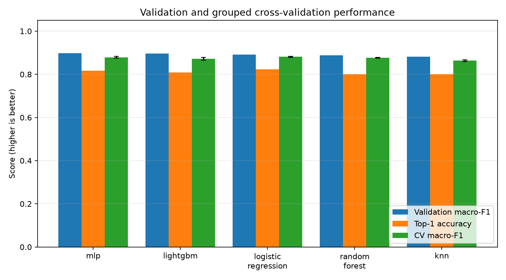
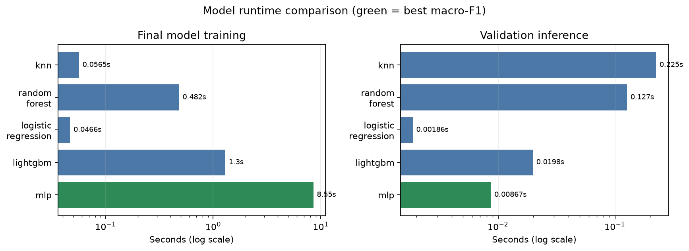

# Model comparison

Models are ranked by validation macro-F1 on the student-test partition. The evaluator partition is not used for model selection.

## At-a-glance comparison

| Rank | Model | Validation macro-F1 | Top-1 accuracy | CV macro-F1 (mean ± std) | Balanced accuracy | Log loss |
| ---: | --- | ---: | ---: | ---: | ---: | ---: |
| 1 | mlp | 0.8985 | 0.8160 | 0.8791 ± 0.0040 | 0.9027 | 0.1126 |
| 2 | lightgbm | 0.8964 | 0.8080 | 0.8717 ± 0.0067 | 0.8922 | 0.1197 |
| 3 | logistic_regression | 0.8918 | 0.8240 | 0.8810 ± 0.0021 | 0.8877 | 0.1243 |
| 4 | random_forest | 0.8877 | 0.8000 | 0.8764 ± 0.0018 | 0.8816 | 0.1947 |
| 5 | knn | 0.8808 | 0.8000 | 0.8631 ± 0.0043 | 0.8748 | 0.7572 |

**Best by validation macro-F1:** mlp (0.8985).

## Performance charts

Validation macro-F1 and top-1 accuracy are evaluated on candidate rows and GPS observations respectively. Cross-validation scores are grouped by trip; error bars show one standard deviation.

## Runtime charts

Runtime is measured during this report run and can vary by machine and system load. The horizontal axes use a logarithmic scale.

## Dataset and run details

- Training candidate rows: 17485
- Validation candidate rows: 2154
- Feature count: 14
- Training candidate coverage: 89.08%
- Validation candidate coverage: 99.79%
- Sampling: At most 25 evenly spaced observations per trip; all candidates for selected observations retained.
- Cross-validation folds: 3

Candidate coverage measures whether the true route candidate was generated; it is not a classifier score.
